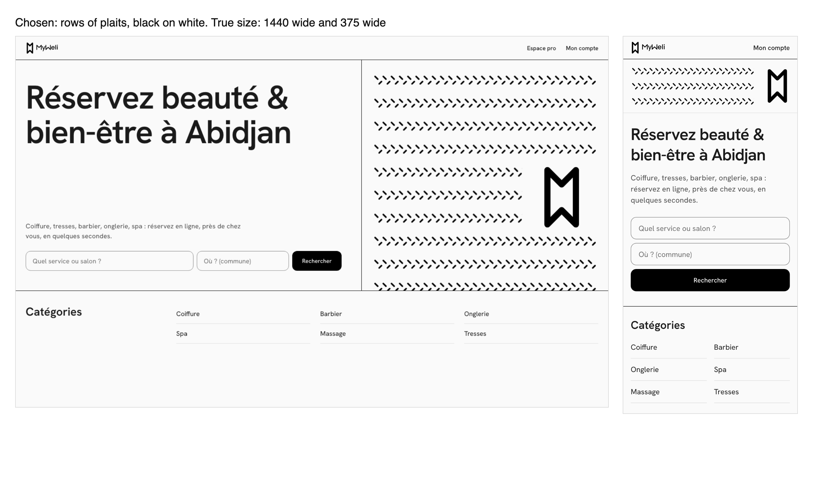

# Web — the public site's look: Swiss structure, the MyWeli logo, a woven pattern — design spec

| | |
|---|---|
| **Status** | **Approved 2026-11-02** (decisions in §15). Direction B, with the owner's two additions: the real logo and the things that are MyWeli's own (§3), and a pattern with an African identity that **feels calm** (§4). **S0 merged in #724 and read back on `myweli.com`** (§11, §13). **S1 merged in #727 and read back on `myweli.com`** (§11, §13.1). **The owner chose to merge it before §4.8 (2026-11-02):** that check and a low-end Android are still theirs, now on the live site, and an answer to question 3 still changes the drawing. Fields and buttons went square in #728 ([web-swiss-fields.md](web-swiss-fields.md)). **S2 merged in #730 on 2026-11-04. `/professionnels` and the 404 read on `myweli.com` in Chromium only: no Safari or WebKit layout, no real phone, and the error pages not read live** (§13.2). **S3 built on 2026-11-05, not merged: its spec, [web-swiss-cards.md](web-swiss-cards.md), approved the same day, corrects §1, §5.3, §6.1, §6.4, §7.3–§7.5, §8–§11 and §13 here, each marked with that date. Where they differ, its §14 says why.** |
| **Owner** | Sadreddine Daher |
| **Last updated** | 2026-11-05 |
| **PRD ref / phase** | FR-WEB-MP-001, FR-WEB-PP-001/002 (presentation only) · V1 |
| **Module** | Web public: `app/page.tsx`, `app/professionnels`, `app/recherche`, `app/[slug]`, `components/home`, `components/landing`, `components/provider`, `Header`, `SiteFooter`, `styles/tokens.ts` |
| **Skills checked** | myweli-web-guardrails ✓ · myweli-verification-guardrails ✓ · no backend change |
| **Depends on** | Nothing. Web merges deploy through Vercel and do not touch the backend, so they do not trigger the Apple keys (B0.12). |

*The chosen direction, rendered at true size from a script (1440 and 375 wide). A sketch, not the final artwork.*

---

## 1. Goal & scope

**Goal.** The public site should look like one brand, made for Abidjan, on a phone and on a large screen. Today it reads as a tidy template.

**What the live site showed on 2026-11-02** (`myweli.com`, 1440 and 375 wide; Planity and Fresha for comparison):

| Finding | Evidence |
|---|---|
| No typeface of its own | Computed `ui-sans-serif, system-ui`. Planity: Aeonik + Inter. Fresha: Roobert. SYSTEM §22 lists « a brand font (Inter) » as deferred |
| A flat hierarchy | `<h1>` 32px at 1440 wide (Fresha 64, Planity 40). `displaySmall/Medium/Large` (36/45/57) exist in `tokens.ts` and **nothing on the web uses them** |
| No image | `/` has one ``, the logo. The hero is pale circles (`HeroBackground`), which SYSTEM §1 calls decoration |
| The logo is small and appears once | `Header` `h-7`. The footer has none |
| No shared left edge | `Header` is `max-w-5xl`, centred. `/recherche` starts at the page edge: at 1440 the logo sits at x = 224 and the `<h1>` at x = 24 |
| Everything is a bordered box | Ten `rounded-xl border` blocks in the source of the home page, `/professionnels`, the landings, the salon card and panel, and the empty state |
| Salon cards have no photo | `ProviderCard` has none. The app's card leads with a cover photo: a parity gap. **Corrected 2026-11-05:** this said « a 180-high cover », which is its grid only; its list uses an 80×80 thumbnail |
| **No salon is public yet** | `GET /providers` → `total: 0`. A design that needs salon photos launches empty |

**In scope.** Tokens and rules (§5, §6), the logo and identity (§3), the pattern (§4), and these pages: `/`, `/professionnels`, `/recherche`, the taxonomy landings, the salon page, 404 and error pages, the OG image.

**Inherits only the font, header and footer, with no layout change:** `/connexion`, `/mon-compte/*`, `/[slug]/reserver`, `/support`, the legal pages, `/pro/connexion`, `/pro/inscription`, `/pro/*`. These are task surfaces; restyling them adds risk and no brand value. The booking funnel keeps its flow as is. **Corrected 2026-11-05:** this contradicted §7.3 and §13's S3, which put the new card in the favourites on `/mon-compte`. The card applies there, and the account's columns, container and states do not. WEB-SYSTEM §16 records the exception, and a stopped favourite no longer being a link is the one flow change (web-swiss-cards.md, decision 3).

**Out of scope.**
- The apps. The font and pattern can reach them later: `AppTheme.themeData(fontFamily:)` is the seam.
- New copy, new features, or any change to a flow, route, API or JSON-LD.
- A commissioned photo shoot. Real photos arrive with real salons (§6.4).

**Flow stays the app's and today's** ([[web-mirror-app-flow]]): search, categories, salons, directory. Same sections, same order, same links.

---

## 2. The direction in four lines

1. **Swiss structure.** One grid, one left edge, one typeface, flush-left text, large type against small, thin rules in place of boxes.
2. **MyWeli's own marks.** The real logo, large enough to be remembered, plus the identity rules we already hold (§3).
3. **African identity through cloth, and calm.** One quiet panel, black on white: long rows, one motif, the logo once, after Baule strip-woven cloth (§4).
4. **Colour comes from people's work.** The interface stays monochrome, so the colour on the page is the salons' photos. Action and status colours stay as SYSTEM §3 defines them.

Why these fit together: strip-woven cloth is already a grid of narrow bands, and the logo is already a strip with a V cut in each end. The cloths that fit best are the quiet ones, and those are real (§4.1).

---

## 3. What represents MyWeli

| Element | Where | Rule |
|---|---|---|
| **Lockup** (`myweli_lockup_horizontal_black.svg`) | `Header`, every public page | Grows from `h-7` to `h-8`. Always links home. Keeps its 48px target. Never redrawn, never typed as text |
| **Wordmark** (`myweli_wordmark_black.svg`) | `SiteFooter`, large, on the grid | About 7 of 12 columns from `lg` and the full width on a phone. Decorative here (`aria-hidden`): the lockup already names the page. **Drawn inline from that file's paths, not as an image** (§13.1), and a test holds them to the file. Smaller on `/pro/*`, see §7.9 |
| **Mark** (`myweli_mark_*.svg`) | In a clearing in the panel and at the end of the phone band | Black on the page's paper, the exact path, large enough to be recognised. Once per form |
| **App icon, favicon** | Unchanged | Already black with the mark |
| **OG image** (`app/opengraph-image.png`) | Link previews | Redrawn: panel on one side, lockup and « Réservation beauté & bien-être en Côte d’Ivoire » on the other. Same 1200×630, same alt text |
| **Pure black fills, ink text** | Everywhere | SYSTEM §1 is unchanged: brand `#000000`, text `#1A1A1A` |
| **Square controls** | Fields, buttons | Square, with a thin black line, since #728 ([web-swiss-fields.md](web-swiss-fields.md)). **Corrected 2026-11-02:** this row first kept them rounded (`radiusLarge`) so that the site and the app feel related; the owner chose otherwise, from pictures, once the home page was live. Chips keep `radiusPill` |
| **The words of the place** | Commune names, FCFA, Wave / Mobile Money | Already on the site; the index treatment (§7.1) makes them part of the look |

---

## 4. The pattern: « le pagne MyWeli »

### 4.1 Does an African pattern fit a calm monochrome brand? Checked against real cloths

**Yes. The first drawing did not, and the cloths are why.**

The owner asked for this to be checked against real examples, and for it to follow the brand and feel calm. Looked at on 2026-11-02:

| Cloth | What it looks like | What it teaches |
|---|---|---|
| [Baule cloth, High Museum](https://high.org/collection/cloth/) | A dark field with long parallel bands of a fine herringbone. The bands look close to rows of braids | One motif, long rows, a lot of quiet. **The main reference** |
| [Baule or Dyula prestige wrapper, The Met](https://www.metmuseum.org/art/collection/search/321366) | Thin light stripes on dark indigo, with small check blocks far apart. The Met calls the patterning « precise yet subtle » | Considered as a second drawing (§4.4) |
| [Baule ikat, Leila Walter](https://leilawalter.studio/blogs/textile-stories/baule-kita-of-cote-d-ivoire-the-strip-woven-handloom-textile-of-central-cote-d-ivoire) | Soft-edged indigo stripes with repeated diamonds | Rhythm. Its softness comes from the dye and cannot be drawn honestly in flat SVG, so not used |
| [Baule cloth, Miami University Art Museum](https://miamiuniversityartmuseum.omeka.net/items/show/2278) | Catalogued as **black and white** cotton in 7-inch bands (the record has no picture) | Black and white is part of this tradition, not only a brand constraint |
| [Bògòlanfini, The Met](https://www.metmuseum.org/art/collection/search/642873), [Cleveland](https://www.clevelandart.org/print/art/2025.270), [British Museum](https://www.britishmuseum.org/collection/object/E_Af1987-07-4) (Mali) | Geometric, but its motifs are **named**, and irregularities are thought to carry coded messages | **Do not borrow its motifs** |
| [Korhogo cloth](https://en.wikipedia.org/wiki/Korhogo_cloth), [Brown University](https://engagingtheamericas.digitalscholarship.brown.edu/off-the-roll-highlights-of-a-global-textiles-project/korhogo-textile-senufo) (Senufo, northern Côte d'Ivoire) | Figures with meanings, some connected to the Poro society | **Do not borrow its figures** |
| [Green Africa, Pentagram](https://pentagram.com/work/green-africa/story) | An airline identity whose logo pieces build patterns inspired by African textiles (read from its description: the video sits behind a cookie choice I did not make) | Precedent for building a pattern out of a logo. Its bright colour is the opposite of our brief |
| [Tensira](https://madegooddesigns.com/tensira-brand-guidelines/) (Guinean-founded) | Described as built on indigo and ecru, with material in place of ornament | Precedent for calm in this territory. The source calls its tones an unofficial reading |

**Why the first drawing failed the brief.** It put seven motifs side by side in loud blocks: a sampler, closer to a souvenir print than to these cloths. It also had none of what makes the brand calm: empty space and one idea at a time. It is withdrawn.

These museum records vary and some Baule cloths are richly coloured and embroidered, so calm is **a choice within the tradition**, not a claim about all of it.

### 4.2 What we borrow, and what we do not

**We borrow the structure:** long parallel rows, one quiet motif, small accents far apart.

**We do not copy:**
- a specific cloth or a named pattern;
- **figurative or named motifs:** Korhogo figures and bògòlanfini's named signs stay out;
- kente, which belongs first to Ghana. Geometry that resembles it by accident gets changed.

**Copy never claims it is traditional or authentic.** It is MyWeli's own drawing. The site says nothing about it.

### 4.3 The calm rules

These decide every later change to the drawing:

1. **One motif per drawing.** No samplers.
2. **Long rows on one field.** Nothing competes with the `<h1>`.
3. **The logo once**, in its own clearing, the largest thing in the panel.
4. **Fine, not chunky.** The motif is texture at reading distance.
5. **Black on the page's white, from the brand's role tokens.** No third colour, no gradient, no pattern behind text. **White on black is reserved for the dark version of the site**, later: drawn with role tokens, it becomes a value swap (SYSTEM §22).
6. **No animation.**

### 4.4 The drawing: rows of plaits (chosen)

Rows of round-ended strokes that meet from both sides, half a step apart: a plait seen flat.

**Why this one.** The motif comes from the product: Tresses is a category, and the rows also read as a woven band. The closest cloth is the High Museum's.

**Compared at true size, and not chosen:**
- **Stripes with small checks, far apart** (after the Met's wrapper). The most Swiss, but it can read as music staves or a circuit, so it says « African » least clearly.
- **The same plaits, white on a black field.** Strong, and kept for the dark version (§4.3).
- **Arrows (>>>).** An earlier draft of this motif. They read as a « fast forward » control, not as cloth.

### 4.5 Forms

| Form | Where | Drawing |
|---|---|---|
| **Panel** | Hero from `lg`, columns 8–12, with a structural rule on its left, running to the container's right edge and from the header's rule to the next rule | Scaled by its width and **cut at the bottom like cloth off a roll**, so nothing is ever cut down its side. Its rows end where the header's links do |
| **Band** | Hero below `lg`, and the 404 page | Three rows and the mark, a row rule under it. Full width on a phone, and stops growing at `sm` (512 wide), flush left |

**Corrected when built, because the pictures showed it (§13.1).** This table first ran the panel to the page's edge and the band at full width at every size. Both scale the motif with the screen: at 1920 the panel was drawn 2.7× and at 768 the band's strokes looked like road markings, which breaks calm rule 4. Capped, it is never drawn above about 2.1×, at any width.
| **OG image** | Link previews | The panel, exported to the existing PNG |

### 4.6 Where it goes, and where it does not (answered)

| Page | Pattern |
|---|---|
| `/` | Panel or band in the hero |
| `/professionnels` | Panel or band in the hero |
| 404 | Band |
| Error pages | **None** (corrected in S2, §13.2): the grid and left alignment only |
| Salon pages, category pages, `/recherche` | **None.** Photos are the content, and the page's job is choosing a salon |
| `/connexion`, `/mon-compte/*`, booking, legal, `/pro/*` | **None** |

**Hard rules, held by tests (§12):** at most one panel or band visible on a page · never behind text · no animation · `aria-hidden`, so it says nothing to a screen reader · no text inside it · inline SVG only, no image file.

**« None » means not drawn, not absent from the page's HTML (read on 2026-11-04, §13.2).** The 404's band is carried in the RSC payload of every page, so it travels with each « None » row too, the five store-linked pages included. It is not rendered there.

### 4.7 Technical shape

- `components/brand/Weave.tsx`, a server component with no client JS, exporting `WovenPanel` and `WovenBand`.
- Colours through the theme's role tokens (`stroke-primary`, the page's `surface`), not literals, which is what makes the dark version a value swap.
- At most **4 KB of markup per page** before compression, pinned by a test. The sketch measured 3.1 KB and 0.8 KB; one 28-high tile, so that a single `<rect>` draws every row, brought the built forms to 1.7 KB together.
  **What that pin reads (checked 2026-11-04):** `site-look.spec.ts` adds up the `outerHTML` of `svg[data-weave]` in the DOM, on `/` only, and `weave.test.tsx` measures the two forms' own markup, on no page. Neither reads the RSC payload, where the same trees travel again. Counted with it, `/` and `/professionnels` are at 5,193 bytes against the test's 4,096: 1,728 in the markup and 3,465 in the payload, about 826 bytes gzipped on `/professionnels`, an estimate. `/` was at 4,144 before S2, from a copy saved that morning. Whether the budget counts the payload is **the owner's call, still open**, with its options in §15 (§13.2).
- Replaces `HeroBackground`, which is deleted, along with its comment about stacking: nothing sits behind text any more.

### 4.8 Before it goes live: people who would know

I cannot judge from here how this reads in Abidjan. **The owner shows the panel to 3–5 people:** salon owners, ideally one Ivorian designer. This was to come before S1 merged; on 2026-11-02 the owner chose to merge first and check on the live site. Four questions:

1. What do you see?
2. Does it feel like here, or like a souvenir?
3. Is anything in it wrong or disrespectful?
4. Would you trust a booking site that looks like this?

An answer to question 3 changes the drawing. The structure of the page does not depend on it: without the pattern, the hero still stands on its type.

---

## 5. Type

### 5.1 The typeface: Hanken Grotesk (answered)

One family at every size. Sizes are the measured `latin` variable `woff2` (Fontsource, `Content-Length`, 2026-11-02). **Read from the chosen file itself** (`fontTools`, Fontsource 5.3.0): all of ASCII and French except « Ÿ », all the punctuation we print, and weights 100–900. **Not carried: U+202F**, the narrow no-break space in every `Intl` French amount, and ★ ♥ ✓ ✕ ← →. The browser draws those from the system stack, as it always did, and on real amounts it looks right. The Google `latin` *range* promised U+202F; the file does not have it, so a range is not evidence.

| Family | Size | Reading |
|---|---|---|
| **Hanken Grotesk** (chosen) | 34.7 KB | Warm and open. Its round forms sit well beside the wordmark's. Second-smallest here |
| Inter Tight | 44.9 KB | The closest to Helvetica, and the most neutral. Planity's body text is Inter, so it is the least ours |
| Schibsted Grotesk | 46.8 KB | The most character. Wide, so long French lines wrap sooner: « Port-Bouët » broke in the sketch |
| Instrument Sans | 30.1 KB | The lightest, slightly condensed and contemporary. Colder beside the logo |

Plain Inter (48.3 KB) is what SYSTEM §22 named, so §22 is updated in the S0 PR.

### 5.2 Loading

- `next/font/local` with the `woff2` committed under `web/styles/fonts/`, with its OFL licence and a note of how it was cut. No build-time network call, exact bytes pinned, and no request to Google at runtime.
- `display: 'swap'`, as WEB.md §7 requires, with `adjustFontFallback` so the swap does not shift the page.
- **Weights 400, 500 and 600 from one variable file, 18.7 KB.** The site uses no others, and cutting the rest is what brought the home page back under budget (§11). It stays preloaded.
- `fontFamily` gets closed in the theme, as the other families were (WEB-SYSTEM §2). `font-mono` has no use on the web today, so nothing is lost.

### 5.3 Sizes

Nearly everything is already a token. Only one is new.

| Role | `<sm` | `sm` | `lg` | `xl` |
|---|---|---|---|---|
| Hero `<h1>`, `/` and `/professionnels` | `displaySmall` 36/44 | `displayMedium` 45/52 | `displayLarge` 57/64 | **`displayPoster` 80/84** |
| Page `<h1>`, salon and landing | `headlineLarge` 32/40 | `headlineLarge` | `displaySmall` | `displaySmall` |
| Section `<h2>`, public pages. **Corrected 2026-11-05:** not `/recherche`'s count, which stays `titleLarge`, and its `<h1>` stays `headlineSmall`: it is a list beside a map | `headlineSmall` 24/32 | `headlineSmall` | `headlineMedium` 28/36 | `headlineMedium` |
| Reading | `bodyLarge` 16/24, as today | | | |

- **`displayPoster` is web-only** and is declared in `WEB_ONLY` (`scripts/dart-tokens.mjs`), since the mirror test fails any undeclared web token. A second token needs a reason.
- Hero sizes add `tracking-tight`. The app's tracking was tuned for Roboto, so body tracking is looked at again on the real font in S0.
- **« bien-être » never breaks at its hyphen.** It breaks badly in French (« bien-/être »). A `whitespace-nowrap` span does it, and the text stays the same for search engines.
- **Prices line up by themselves.** Every digit in this font has the same width, and it has no `tnum` feature, so `tabular-nums` would do nothing. (Corrected: this line first asked for it.)

---

## 6. Grid, rules, photos

### 6.1 The grid

- **One container on every public page:** `mx-auto max-w-screen-2xl px-m lg:px-l`, in one shared constant (`SITE_CONTAINER`, `lib/siteGrid.ts`) so it cannot drift.
- `grid-cols-12` from `lg`, one column below it. Gutters `gap-x-m`, `lg:gap-x-l`.
- Reading paragraphs stay capped at `max-w-content` (SYSTEM §10).
- **Hanging headings** from `lg`: the `<h2>` in columns 1–3, the content in 4–12. Stacked below `lg`.
- **Flush left, everywhere on these pages.** Empty states included: `EmptyState` gains an `align` option, and its default stays centred for the pro pages. **Corrected 2026-11-05:** the public pages only. The favourites' empty state stays centred with the rest of the account.

### 6.2 One left edge

The logo, the `<h1>` and the first section start at the same x on every public route, at every width (the defect in §1). `/recherche` runs full width, so `SiteChrome` passes it a full-width header. Held by an e2e test (§12).

### 6.3 Rules instead of boxes

| Rule | Token | Use |
|---|---|---|
| Structural | 1px `border-primary` | Under the header, between sections, above the footer |
| Row | 1px `border-divider` | Between list rows, as SYSTEM §3.3 already defines |

Black structural rules are a **new use of `primary`**, recorded in WEB-SYSTEM. `Card` stays for what is a real container: the booking panel, the pro pages, the account. The page background stays `surface`, so no rule about `secondary` changes.

### 6.4 Photos

- **Same-ratio crops:** 4:3 on cards, 3:2 on the salon cover, through two named `aspectRatio` tokens. Same-ratio crops are what make uneven phone photos look like one set. **Corrected 2026-11-05:** `card` arrives with S3 and `cover` waits for its first user in S4. This said the app's card is close to 4:3, which is only its two-column phone grid (1.24–1.36): its carousel is 1.56, one column 1.82, its list 1:1. The decision stands. **Added 2026-11-05:** each ratio is cut at one place, `object-subject`, 50% 20% (web-swiss-cards.md §11, decisions 2 and 8). The cover takes it now in its present box, and keeps it when its 3:2 arrives in S4.
- **The crop is a little above the centre, 50% 20%, on cards and on the salon cover. Corrected 2026-11-05:** this said it was centred, as the app's, which was signed without seeing a portrait and was wrong. In a crop test on the real card, centre lost a tall updo whole, `object-top` turned upright rooms into ceilings, and 20% kept the heads and the rooms (web-swiss-cards.md §2.4, decisions 2 and 8). The app stays centred until after Apple's decision (BACKLOG B12.13). The test's portraits were the owner's private AI stand-ins, never committed: the rule three lines below does not change.
- **Square corners**, so the grid stays visible.
- **No filters and no scrims.** Hair colour is information.
- **No AI-generated faces or results** anywhere on the site. A fake result on a booking site misleads people.
- **A salon with no photo:** its logo on `surfaceVariant` if it has one, otherwise its initial in display type. Never a stock image and never the pattern. **Added 2026-11-05:** the logo is contained, 2/3 of the tile, in the bottom-left corner with no padding, on the name's x. Any ratio can arrive, often opaque (web-swiss-cards.md §2.2, decision 2).

---

## 7. Page by page

Sections, order, links, headings' words and JSON-LD stay as they are. Only the presentation changes.

### 7.1 `/`

| Section | Phone | From `lg` |
|---|---|---|
| Hero | Band, `<h1>`, lead, `HomeSearch` stacked | Columns 1–7: `<h1>` at the top, lead and search on the panel's bottom line. Columns 8–12: panel |
| Catégories | Same six links, same order, as a ruled index in 2 columns, `min-h-12` cells | Hanging heading, 3 columns |
| Salons populaires | Tile cards. **Hidden at 0 salons, as today** | 4 across |
| Partout à {ville} | One `
` per commune with a 48px `
`; the links stay in the served HTML | Hanging heading, 4 columns, always open. Two forms of one list, one `display: none`: a `
` forced open by CSS would tell a screen reader « collapsed » about links it can see |
| Value props | Stacked, each under a rule, no card | 3 columns |
| L'app MyWeli | Only when `appStoreUrl()` has a value, as today | Same |
| Vous êtes un salon ? | Rule, heading, text, secondary button | Hanging heading |
| FAQ | Rows | Hanging heading. `dl` unchanged |

The search stays visible without scrolling at 360×640.

### 7.2 `/professionnels`

Same hero layout. Benefits as a ruled 3-column list. **Steps with large numerals** in place of the small black discs. FAQ with a hanging heading. Closing row under a rule. Its rule of one filled action per screen stays.

### 7.3 `ProviderCard`

Two layouts, one component, with every existing prop unchanged:
- `tile` (home, landings, favourites): photo on top.
- `row` (`/recherche`): photo on the left, 1/3 of the width.

No box: a rule and a hover state. `next/image`, lazy, with real `sizes`. The rating, the « Nouveau » pill and the favourite heart with all its states stay as they are.

**Corrected 2026-11-05, by [web-swiss-cards.md](web-swiss-cards.md) §2.2, which now governs the card:**
- **Layouts:** a third value, `rowOnPhone`, the same two switching at `sm`, for the favourites: as tiles they would push support and account deletion down 1186px on a phone, and rows push them 64px (corrected 2026-11-05: this read 1082). `row` holds at every width, as this says, though all three competitors stack on phones (decision 2).
- **Props:** all five stay. `layout`, `imageSizes`, `imagePriority` and `linked` are additive. `linked={false}` is a stopped favourite, whose link ended on a 404 (decision 3).
- **Where the rule goes:** at the foot of the media block, and the list draws the lines between rows. Hover and focus underline the name, because the old hover would hide a no-photo tile.
- **« Lazy », except one photo per level. Corrected again 2026-11-05.** A card photo is the Largest Contentful Paint on landings and `/recherche` at 412×823, so `priority` on the first card was tried per level under the rule in its §7. On Lighthouse's simulated estimate no level earned it, and this line said it came out. That estimate does not model the request starting earlier, so the owner had the rule read applied throttling (`--throttling-method=devtools`), where all four levels keep it. The first photo is fetched first on root, city, area and `/recherche`, meaning the first salon that has one and not the first card (its decision 6), every other photo stays lazy, and `/` and the favourites stay all lazy. Same bytes either way, and no budget moved.
- **« Real `sizes` »:** one layout, three grids, and a wrong `vw` silently drops candidates, hence `CARD_SIZES`.
- **The rating:** the same component, on its own line in the app's order, with its count, « ★ 4,8 (32 avis) » (decision 4).
- **The heart** is not placed here. It stays bottom-right, off the photo, with a spacer as tall as the heart.

### 7.4 `/recherche`

Same list and map, same filters, same mobile toggle. The map is untouched. Cards use `row`, and the full-width header starts at the list's left edge.

**Corrected 2026-11-05:** this left out the empty state, now flush left (§6.1), and the selection ring, now square with `ring-offset-2`, on every row's `py-m` (§6.3). « Same filters » holds, except that « Trier » can now shrink, because it scrolled the page sideways at 320 with doubled text (web-swiss-cards.md §2.3).

**Corrected 2026-11-05, after the before and after:** « same mobile toggle » holds for its words and behaviour, not its place. Centred, it covered more of the new rows' text than of today's cards, so the owner moved it to the page's gutter, over the photo column (web-swiss-cards.md §2.4, decision 5). **Corrected again the same day:** it stays at the screen's foot while the list scrolls and stops above the footer, because as a fixed button it stood on the footer's last link, and a press there opened the map (the same decision).

### 7.5 Landings

`max-w-content` becomes the site grid. Reading text stays capped. Cards 3 across from `lg`. Sibling chips stay chips. The empty state goes left-aligned with its current words. The FAQ follows §7.1.

**Corrected 2026-11-05:** sections are hanging, §6.1's default. The city links this left out become a ruled index, the home page's Catégories treatment. The FAQ follows §7.1 through a new `SiteFaqList`, because `Faq` is shared with the salon page, whose own container breaks the edge: it waits for S4 (web-swiss-cards.md §2.3).

### 7.6 Salon page

- Phone: unchanged order, and the sticky booking bar stays.
- From `lg`: cover in columns 1–8 at 3:2. Columns 9–12: name, rating, `BookingPanel`, sticky.
- Sections below get a structural rule and a larger `<h2>`.
- The salon's own logo stays on its cover (salon-logo.md §5).
- No pattern (§4.6).

### 7.7 404 and error pages

The 404 is left-aligned with the band. The error pages are left-aligned on the grid, with no band (§13.2). The wording stays as tests hold it.

### 7.8 Header and footer

- **Header:** lockup, « Espace pro », bell, « Mon compte », same links, a black rule under it. **No « Espace pro » on the five pages the apps open** ([app-review-round-2.md](app-review-round-2.md) §5).
- **Footer:** large wordmark, then the same three link groups and the same `rel="me"` links, on the grid. **Two groups on the five pages the apps open** ([app-review-round-2.md](app-review-round-2.md) §5).

### 7.9 `/pro/*`

Gets the font only. `SiteFooter` is a server component shown on `/pro` too (its comment says why), and a poster-size wordmark under an agenda is wrong. So the large wordmark is on public routes, and `/pro/*` gets the lockup at `h-8`. The footer stays a server component. **Decided in S1:** a small client leaf (`FooterMark`), because `SiteChrome` already ships `usePathname` on every page, while passing it from layouts means moving every page into route groups. `/pro/connexion` and `/pro/inscription` keep their own header, moved onto the same container and rule, or their two logos would start 200px apart at 1440.

---

## 8. States and edge cases

| Case | Behaviour |
|---|---|
| 0 salons (today) | Home hides the section. Landings show the empty state. The hero stands on its type and pattern: **no page depends on a photo** |
| Locality tree unreadable | As today: « Abidjan » fallback, directory hidden, search still works |
| Font slow or blocked | System fallback with adjusted metrics, then a swap. Text is never hidden. **Corrected 2026-11-02:** this said « no visible jump », and it can re-wrap a paragraph, which measured 0.064 on `/suppression-compte` against the 0.1 budget (WEB.md §7) |
| Salon with no photo | §6.4 |
| Photo fails to load | The `surfaceVariant` tile stays and the ratio holds, so there is no shift. **Corrected 2026-11-05:** Chromium also draws a broken-image mark, and a pale tile says nothing while a photo is slow, so the salon's letter sits under the photo and in the failed image's `::after`. In Safari a failed photo also shows a small blue « ? » and a thin outline (web-swiss-cards.md §2.4) |
| Long city or salon name | `displaySmall` fits « Yamoussoukro » at 320 wide by estimate; `type-overflow.spec.ts` decides. `break-words` on `<h1>`. **Corrected 2026-11-05:** this said declared `truncate` on card names stays. That `truncate` did not truncate, and at doubled text it cut short names for the reader who enlarged them, so names wrap (decision 2) |
| A control under 48px | **Added 2026-11-05:** « Retirer des favoris » and a landing's crumbs measured 20px. Both raised to the floor, no word changed |
| 320 wide, 400% zoom | One column. The band fills the width. Covered by the reflow gate |
| Large browser font | Same limit as today: type is `px`, boxes are `rem` (WEB-SYSTEM §9). Not made worse |
| Forced-colours mode | The pattern is decorative. Text and controls are the system's |
| Install banner present | A black band above the header, then a black rule. Looked at in S1 |
| Symbols ★ ♥ ✔ ✕ | Not in the font: they fall back to the system as they do now. Icon sizes checked in S0 |
| Multi-pays | `{ville}` comes from the tree. The pattern is not tied to one city |

---

## 9. API, data, contract

None. `imageUrls` is already `required` on `Provider` in `openapi.yaml`, and `imageUrls[0]` is already the listing cover. To confirm in S3: the real list read returns it (the app's card relies on it and the stub has it).

**Answered 2026-11-05: in code yes, live no.** The route returns repository maps with no projection, and the repository selects the whole document. No live read is possible, because `GET /providers` reads `total: 0`, and nothing pinned it. So one backend test, test only, in its own PR, because any file under `backend/` starts `deploy-backend.yml` (web-swiss-cards.md §3, §9).

---

## 10. SEO / AEO / GEO

- Same `<h1>` words, canonical URLs, metadata and JSON-LD on every page. A test compares them before and after (§12).
- The directory's links stay in the served HTML inside `
`.
- Sitemap and `llms.txt` unchanged.
- Salon card photos need real `alt` text, not `alt=""`, since they are content. Words: the salon's name. **Corrected 2026-11-05:** this added « as the hero's alt already does », and the hero says `Salon {name}`, so « Salon Salon Excellence » is possible. Cards use the bare name, and `Hero` is S4's.

---

## 11. Performance and security

**Budgets stay and are not raised:** LCP < 2500 ms, CLS < 0.1, TBT < 200 ms on `/` (`lighthouserc.json`).

| | |
|---|---|
| **Before the font, five runs** | `/` **LCP median 2314 ms**, first paint 757 ms, CLS 0. So about 190 ms of room. A single CI sample of 1815 ms looked like 685: this metric sits in two modes, and `lhci` uploads one run |
| **With the full file, 34.7 KB** | **2607 ms, over budget.** Not preloading it gives 2472 ms but first paint goes from 757 to 1060 ms: worse for visitors, and hardly better for the score |
| **Trimmed to 18.7 KB, preloaded** | 2457 ms on `/` (2454–2490), first paint 757 ms, CLS 0. Full table in WEB.md §7 |
| **That still failed** | CI's gate failed on `/suppression-compte`: 2505 ms. Measuring only `/` had missed it |
| **What paid for it: Sentry's tracing code out of the bundle** | Scripts 203 → 158 KB. We report errors only, so every visitor was downloading code we switch off at runtime. **`/` 2110 ms, `/suppression-compte` 2109 ms**, faster than before the font, first paint still 757 ms. A real error still reaches Sentry: seen on a build with a local DSN |
| **On `myweli.com` after the merge, five runs** | `/` 1263 ms, `/connexion` 1274 ms, `/suppression-compte` 1480 ms; CLS at most 0.006; scripts 152–153 KB on `/`. WEB.md §7. These are not comparable with the local numbers above, so S1 measures against the local ones |
| **S1, five runs, every budgeted page** | `/` **2113 ms** (2112–2173), `/connexion` **2713 ms** (2711–2759; `main` 2712), `/suppression-compte` **2109 ms** (2108–2263). First paint 759, 907 and 756 ms. CLS 0, TBT 0. Scripts 158, 231 and 159 KB. So it cost `/` 3 ms and left the others where they were |
| **S1 on `myweli.com`, five runs** | `/` 1487 ms, `/connexion` 1323 ms, `/suppression-compte` 1607 ms; TBT at most 26 ms; scripts 152 KB on `/`. WEB.md §7 |
| **S2, five runs each, on a local build** | `/` 2115 ms, `/connexion` 2713 ms, `/suppression-compte` 2109 ms, all where they were; `/professionnels`, which has no budget, 2148 ms. CLS 0, TBT 0 |
| **S2 on `myweli.com`, five runs, 2026-11-04** | `/` 1906 ms (1304–1920), `/connexion` 2207 ms (1914–2218), `/suppression-compte` 1309 ms (1163–1615), all within budget; `/professionnels`, which has no budget, 1160 ms (1152–1461). CLS at most 0.064, TBT at most 53 ms. WEB.md §7. From a Mac, so not comparable with the local numbers above, and with no like-for-like before: no regression is claimed, and none is ruled out |
| **If it breaches** | The budget does not move |
| **New photos** | Card photos are lazy and below the fold on `/`. Salon page budgets are set from a measurement in S4, added to `lighthouserc.json` so they cannot be forgotten. **Corrected 2026-11-05:** « below the fold » holds only for `/` at the sizes Lighthouse and a desktop use: at 820×1180 the photo is the LCP there too, recorded and not changed. Landings and `/recherche` have no budget in S3, because CI cannot serve a photo and production's landings are empty: they are measured once by hand, and the gate moves to B11.4 (web-swiss-cards.md §7). There the first photo is fetched first, on the owner's choice (its decision 6) |
| **Transformations** | **Added 2026-11-05:** with Next's default of 60 s most photo views would be a billed transformation, so `images.minimumCacheTTL` is 31 days. It is global, and erasure deletes review photos, so `AvisClient` shows those `unoptimized` (web-swiss-cards.md §6, §7, decision 1) |

**Security.** CSP's `font-src 'self'` already allows `next/font`'s files, and no new origin appears. No third-party font request, which also keeps the privacy policy true. No secrets. **Read back after S0:** the served header has `font-src 'self'`; the font comes from our own origin and is byte-identical to the committed file; five pages read, none referring to Google Fonts. Error reporting still initialises and a clean load sends nothing, but a real error reaching Sentry from the live site has not been seen.

---

## 12. Tests

Each new guard ships having been watched red, on committed work.

| Guard | What it holds | How to turn it red |
|---|---|---|
| `served-html` / e2e | `body` computes the brand font, and the `woff2` answers 200 from our origin | Remove the font class |
| `tokens.mirror` | `displayPoster` is declared web-only | Remove it from `WEB_ONLY` |
| `tokens.theme-pin` | The closed `fontFamily`, and the emitted tokens | Use a non-token family |
| **New: left edge** | Logo x = `<h1>` x = first section x, at 320 to 1920. On `/` and `/recherche` from S1; each other public route joins when its slice moves it to this grid | Change one container's padding. Must fire on `/recherche` at 1920 |
| **New: pattern rules** | `aria-hidden`, no `<text>`, no hex literal, ≤ 4 KB in the DOM (§4.7), at most one **visible** per page; drawn on `/` and `/professionnels`; **not drawn** on salon, landing, `/recherche`, `/connexion`, `/pro`, where the DOM has no `svg[data-weave]`. The RSC payload is not read (§4.6) | Add a band to a salon page |
| **New: logo** | The lockup in the header is the real file and the wordmark's paths are that file's, on each public route | Replace one with text |
| **New: the footer is never the page's LCP** | On short pages at 412 × 823 and 1440 × 900, the last LCP entry is outside the footer | Make the wordmark an `` again |
| **New: SEO unchanged** | `<h1>` text, canonical and JSON-LD on `/`, `/professionnels`, a landing and a salon match a checked-in list | Change a word |
| `type-overflow` | Reflow at 375 / 320, with `/professionnels` and a long-city case added if missing | A nowrap hero that spills |
| `tap-targets` | Add category cells, directory `
` and links, footer links | Remove `min-h-12` |
| `axe` | Existing routes, including the new `
` | Existing |
| Lighthouse | Existing on `/`; salon page added in S4 | Existing |
| Unit | `ProviderCard` no-photo cases: logo, initial, unnamed salon (SYSTEM §17.2) | Drop a branch |

**What these cannot see.** WEB-SYSTEM §9 says it plainly: there is no screenshot harness on the web, and ugly-but-not-clipped passes every gate. So each PR carries before and after pictures at 360, 768, 1440 and 1920, and they get looked at. **Real-phone check by the owner** on a low-end Android at S1, since font rendering there cannot be judged from this Mac.

---

## 13. Rollout

Six PRs, in order, each merged only on the owner's word. A merge is a production web deploy, so each is verified on `myweli.com` afterwards.

| # | Slice | Done when |
|---|---|---|
| **S0** | Font trimmed to 18.7 KB, `displayPoster`, `fontFamily` closed, the rules in WEB-SYSTEM §16, SYSTEM §22. **No layout change.** The grid constant moves to S1, its first user: nothing here would use it | Lighthouse measured on the font alone. Every e2e green, including `/pro` |
| **S1** | `Weave`, `Header`, `SiteFooter`, `/`. Delete `HeroBackground` from `/` | Merged on the owner's word. §4.8 and the real-phone check follow on the live site |
| **S2** | `/professionnels`, 404 and error pages. `HeroBackground` deleted | Merged in #730 on 2026-11-04. `/professionnels` and the 404 read on `myweli.com` in Chromium only, the error pages not read live (§13.2) |
| **S3** | `ProviderCard`, `/recherche`, landings, favourites list. Spec: [web-swiss-cards.md](web-swiss-cards.md) | Cards with and without photos looked at. **Corrected 2026-11-05:** that cannot be done on production, which has no public salon. Locally now, on the live site when a salon is public, with a scheduled check for that day (its §9) |
| **S4** | Salon page. Budgets added | Salon LCP measured |
| **S5** | OG image. Audit of every page against this spec **on the deployed site**, by separate eyes told to refute it | Findings fixed or filed |

### 13.1 S1: what looking at it changed

Built to §7.1 and §7.8, and looked at from 360 to 1920 ([before and after](assets/web-swiss-s1.png)). Five things it turned up, nearly all of them invisible to a test:

| Seen | Done |
|---|---|
| At 768 the band was 220 high and heavy | It stops growing at `sm` (§4.5) |
| At 1920 the panel reached the page's edge, drawn 2.7×, and the cloth was about to cut the logo; at 2560 it did | It ends at the container (§4.5), so its scale tops out at 2.1× and the logo ends 446px down a 576px hero. Pinned to 2560 |
| The large wordmark's M started 19px right of the text under it, from empty space in the file | Its viewBox starts on the M's ink, and everything else stays the file's (§3) |
| At 412 × 823 on `/connexion`, the footer is on screen at first load, and as an `` the wordmark became the page's Largest Contentful Paint. Found by asking which element it was, since the number looked fine | Drawn inline: inline SVG is not a candidate, and it costs no request. The page's number did not move either way (2712 on `main`, 2712 with the image, 2713 inline), so this is about a decoration not being what the metric measures, and it is now held by a test |
| A pale sliver at the end of every row: the tile's ink, wrapped round by the browser | The ink now sits a little clearer of the tile's sides |

**Still to look at, in the owner's hands:** whether the wordmark at 7 of 12 columns is too loud under a short page such as `/connexion`. It follows §3, but no sketch had shown it.

**The install banner and « L’app MyWeli »** appear only once store URLs exist, so they were looked at on a build with a temporary one: the banner is on the same left edge, a black band above the header's black rule, as §8 expected.

**Read back on `myweli.com` after the merge:** the band on a phone and the panel on a desktop, none on `/connexion`, `/support` or `/pro/connexion`, the wordmark in the footer and the lockup on `/pro/connexion`, no sideways scroll, no CSP message, and all ten privacy checks.

**What is not done here:** the salon card keeps its box until S3, and `/professionnels` keeps `HeroBackground` until S2. Nothing was seen on a real phone.

### 13.2 S2: `/professionnels`, 404 and error pages

Built to §7.2 and §7.7 ([pictures](assets/web-swiss-s2.png)). `SiteHero` now holds the hero for `/` and `/professionnels`, and `HeroBackground` is gone. No word, link or JSON-LD changed.

| Decided or found | Why |
|---|---|
| **The error pages get the grid and no band** | §4.6 said « 404 and error pages », but the owner's answer was « Home, Pro page, 404 ». `app/error.tsx`'s chunk is in every page's scripts, so a pattern there costs every visitor for a page few see |
| **`global-error` takes the grid and left alignment only** | It replaces the root layout, and depends on as little as it can |
| **The 404's button and `global-error`'s were under the 48px floor** | Both 36px, since they were hand-written. The 404 now uses `ButtonLink`, and `global-error` has `min-h-12` |
| **« (24 / h et 2 h avant) » split across a line at 1440** | No-break spaces, there and on the account's notifications page. No word changes. A test now holds `/professionnels` |
| **Noticed, not touched:** the page's served title ends « … en Côte d’Ivoire · MyWeli », after opening « MyWeli Pro », so the brand is in it twice | S2 changes no search-engine text. For the audit in S5 (B11.5) |

**At 360 × 640** the whole hero fits, with 114px to spare above the fold's limit for the filled action.

**Read on `myweli.com` after the merge (2026-11-04, `a41f7db9`): the 404's band is in every page's HTML.** This was not recorded when it was built. Next.js serializes the root 404 into every page's RSC payload (read on nine pages), so the first row's reason applies to the 404 as well: it costs every visitor for a page few see. Q3 in §15 was answered before this was read.

- **On the five store-linked pages** ([app-review-round-2.md](app-review-round-2.md) §5, §12) it is not rendered, with no `svg[data-weave]` in the DOM, and it adds no route to sign-up: their HTML has no `/professionnels`, `/pro/inscription`, `/pro/connexion`, « Espace pro » or « Inscrire », and the fragment's one link goes to `/`.
- **What it costs.** On each of the five, the 404's fragment grew from 585 to 1,990 bytes, against copies saved before the deploy, and nothing else in those files changed but same-length hashes. The band's tree is 1,049 of those bytes. Compressed, the saved copy against the live one, each from one encoder: gzip at level 6 about +350 to +530 bytes a page, and brotli about +310 to +370 at qualities 5 and 11. Putting the real old fragment back into the live file gives about the same gzip growth, and cutting from the live HTML saves about 270–440 bytes of gzip for the band alone and 470–650 for the whole fragment. Browsers get brotli, and Vercel's own served bytes have no before, so these are a guide and not what a visitor is sent.
- **Speed.** No like-for-like before exists, so nothing is claimed either way. Read live, five runs each from a Mac: `/` 1906 ms, `/connexion` 2207 ms and `/suppression-compte` 1309 ms, all within budget, and `/professionnels`, which has none, 1160 ms (§11). The LCP element on `/` and `/professionnels` is the `<h1>`, not the pattern.
- **The budget.** Counted with the payload, `/` and `/professionnels` are over §4.7's 4 KB, and its tests do not read the payload. **Whether the budget counts the payload is the owner's call, still open, with its options in §15.** Taking the band off the 404 would change the HTML of the five pages again, so it waits on B0.1's merge rule.

**What that read covered, on 2026-11-04, signed out, in Chromium 149 only.** `/professionnels`: its 36 main strings against `landing.ts`, its 15 anchors, served and hydrated, and its `<head>` and JSON-LD. Both pages: the six required sizes and 367 widths from 320 to 2560, 200% text four ways at 390, axe at 360 and 1280, and console and CSP events. The read of the five pages ([app-review-round-2.md](app-review-round-2.md) §12) landed on both in WebKit, for their headings and links and not their layout. **Not read:** their layout in Safari or WebKit, so iPhone Safari is unverified; a real phone, or real iOS or Android text scaling; a signed-in visitor, so the bell at 360; the install banner's effect on the fold, since none appeared; and **the error pages, `app/error.tsx` and `global-error`, which this read did not open**, so « read on `myweli.com` » does not cover them.

**During App Review.** `/support` and `/politique-confidentialite` are listed with Apple and they keep their wording. They change only in font, header and footer, and they get checked after each deploy. Timing against Apple's decision is the owner's call at each merge. Read after this deploy: words and links unchanged on all five, with their HTML grown as above ([app-review-round-2.md](app-review-round-2.md) §12).

**Mixed look between merges.** Accepted: there is no public traffic to speak of (memory: not yet public), and each slice stands on its own.

---

## 14. Definition of done

- [ ] Typecheck, lint, `vitest`, `next build`, Playwright, axe, Lighthouse green; no budget raised.
- [ ] Every new guard watched red; recorded in the commit.
- [ ] Tokens only, with no new undeclared `ds-ignore`.
- [ ] Four states kept on each page.
- [ ] Parity: salon cards gain the app's cover photo.
- [ ] App-install push unchanged.
- [ ] H1, canonical, JSON-LD unchanged.
- [ ] Pictures in each PR, looked at. Deployed site read back.
- [ ] WEB-SYSTEM (new section on the public-page language), SYSTEM §22, this spec, the README index, BACKLOG and the roadmap entry kept true.
- [ ] Feature branch + PR, CI green, no Claude attribution.

---

## 15. Decisions

All answered by the owner on 2026-11-02 (BACKLOG decisions 63–67).

| # | Question | Answer |
|---|---|---|
| Q1 | Pattern colour | **Black on white**, on condition that it fits African patterns, the brand, and feels calm. Checked in §4.1: it does, once redrawn. White on black is kept for the dark version |
| Q2 | Typeface | **Hanken Grotesk** |
| Q3 | Where the pattern goes | **Home, `/professionnels`, 404** (§4.6) |
| Q4 | Which drawing | **Rows of plaits** (§4.4) |
| Q5 | What comes first | **The untrue sentences** ([web-flow-audit-2026-11.md](web-flow-audit-2026-11.md)), **then the new look** |

**Left with the owner:** §4.8, showing the panel to people in Abidjan before S1 goes live. I cannot judge that from here.

**Also left with the owner, from the read of 2026-11-04 (§4.7, §13.2; BACKLOG B11.2): does §4.7's budget of 4 KB of markup count the RSC payload?**

- **(a) It means drawn markup.** Then §4.7 says so, and the two tests whose names say « what a visitor is sent » (`site-look.spec.ts`) and « every visitor is sent both » (`weave.test.tsx`) are retitled. The payload's 3,465 bytes stay uncounted.
- **(b) It counts the payload.** Then `/` and `/professionnels` are over, at 5,193 bytes against 4,096. Taking the band off the 404 still leaves them 48 bytes over, at 4,144, so the budget, the drawing or the way it is delivered must move too, and the pins must read the payload.

Any web change waits on the merge rule in B0.1 (BACKLOG).
